




<a href="https://github.com/srivathsa12/my-portfolio"></a>
<a href="https://github.com/srivathsa12/digital-detective-8490"></a>
<a href="https://github.com/srivathsa12/scheduled-tasks"></a>
<a href="https://github.com/srivathsa12/srivathsa12"></a>

  


  


<a href="mailto:sherlasrivathsa12@gmail.com"></a>

  


